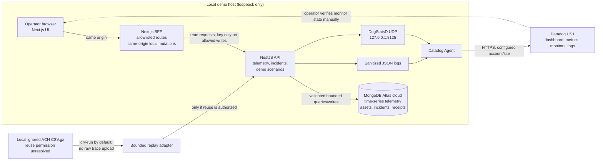

# ChargeGuard architecture — Phases A–C implemented locally

## Implemented telemetry and incident path

```text
Local ACN-Data static CSV.gz (ignored; replay only after rights verification)
   └── LocalAcnCsvAdapter (stream, downsample, event-time mapping, provenance)
        └── replay-acn CLI (dry-run default; --execute explicitly required)
             └── POST /api/v1/telemetry[/batch] · x-api-key
                    ├── validate event, timestamp, units, station/charger IDs
                    ├── ingestion_receipts (ordinary collection, unique _id)
                    └── telemetry (MongoDB time-series, BSON ts, meta stationId/chargerId)
                           └── GET history, latest, averages, states, activity, station summary
                                  └── Next.js operations dashboard (loopback)
                                       └── allowlisted BFF routes; local-only mutations
```

## Submission architecture diagram specification

This Mermaid source is the canonical diagram specification for the submission deck/video. Keep the boundaries visible: the browser uses the same-origin BFF, the BFF keeps the API key server-side, mutation access is local-development-only, and Datadog is an observability sink rather than an incident-control API.



### Diagram notes

- The NestJS API and web development server bind to `127.0.0.1`. This runbook uses a local demo strategy; it does not present an unauthenticated remote surface as production-ready.
- The backend ingestion key protects writes. The BFF injects it only for its explicit, validated mutation allowlist. The browser never receives it.
- MongoDB time-series telemetry and ingestion receipts have seven-day retention. Demo baseline/reset emits new synthetic telemetry; it does not delete source data or unrelated records.
- ACN data is historical source material and remains local/ignored until redistribution rights are resolved. Demo fault/recovery signals are generated synthetic data.
- Datadog US1 verification evidence is historical unless a current authenticated observation is captured with timestamp and monitor ID.

Code lives under `apps/api` (NestJS 11 / TypeScript / official MongoDB Node.js driver) and `apps/web` (Next.js App Router). The backend includes charger and station reads, incident lifecycle actions, and synthetic demo controls. The frontend provides overview, charger detail, incident management, and demo-control screens; it polls the API through a same-origin BFF. A singleton MongoDB connection is established and pinged at startup, closed on shutdown, and checked by `/api/v1/health/ready`. Swagger lives at `/docs`; all API error responses are sanitized. `MONGODB_DATABASE` must equal `chargeguard`, and the ingestion API requires `INGEST_API_KEY` outside test environments.

`db:init` is repeatable and initializes `stations`, `chargers`, `incidents`, `incident_actions`, `ingestion_receipts`, and time-series `telemetry` (time field `ts`, meta field `meta`, granularity `seconds`, TTL 604800s). Regular collections provide unique `_id` receipt enforcement and operational indexes; telemetry uses non-unique compound indexes on `meta.chargerId`/`ts` and `meta.stationId`/`ts`. The five virtual charger records are seeded via upsert, retaining existing data. The dedicated `chargeguard_dev` database account has the scoped `chargeguard_rw` role.

**Idempotency:** SHA-256 digest of `stationId`, `chargerId` and `eventId` identifies a receipt. The canonicalized payload fingerprint rejects reuse of the same key for different values. The receipt is inserted before time-series telemetry, then marked committed. On a retry for `PENDING`, the API checks for an already-inserted time-series reading before resolving it. Unknown outcomes intentionally remain `PENDING` to avoid duplicating time-series writes; they can require operational reconciliation. Time-series uniqueness is not assumed. Receipt TTL yields a seven-day deduplication horizon, with partial success possible in sequential batch ingestion.

**Aggregation:** all telemetry lookups bound `ts` to a finite date range (default last 24h, max 31d). `chargerId`/`stationId` filters and query limits are available; a demo-scale cap of 500 assets is imposed where full asset lists are needed. `active` means recently *observed by telemetry*, not a guarantee a charger is electrically available. Current average excludes rows missing `currentA`, and charging-state distribution counts recorded events rather than elapsed time.

**Data integrity:** `sourceEventAt` retains historical timestamps while replay `ts` reflects demonstration time; `provenance.fields` explicitly separates MEASURED, SOURCE_REPORTED, DERIVED and SYNTHETIC. Missing sensor channels stay missing. The current threshold used to derive app charging state is a demonstration assumption. Detected energy counter decreases are flagged. Session IDs are pseudonymous; the raw file path and source identifiers are never sent to Atlas by the adapter.

**Data and access boundaries:** the five static source files were used only for local inspection/dry-run and remain ignored. The current local API readiness endpoint returned `ready` with `database: connected`; earlier independent TLS failures remain documented in [the preparation report](PREPARATION_REPORT.md), and this runtime result is not a new permission audit. The API and web development servers bind to loopback. The BFF restricts mutations to an allowlist, same-origin loopback development requests, and bounded validated JSON; production mutations are rejected. This boundary is not operator authentication, so remote deployment remains blocked.

## Implemented Phase B/C components
- **Replay and synthetic scenarios:** bounded ACN replay remains dry-run by default. Demo controls generate labeled synthetic fault/recovery telemetry and incident actions; they do not actuate physical chargers.
- **NestJS API:** telemetry ingestion and bounded aggregation, charger/station reads, incident listing/detail/acknowledgement/resolution, and demo trigger/recover/reset routes.
- **MongoDB Atlas:** time-series telemetry and regular collections for stations, chargers, incidents, incident actions, and ingestion receipts.
- **Next.js UI:** operations overview, charger detail with measurement provenance and stale-data indication, incident queue/timeline, and demo control center.
- **BFF:** explicit path/method allowlist, same-origin loopback policy for development mutations, body/schema limits, server-side API key, sanitized proxy errors, and production mutation denial. It does not authenticate human operators.
- **Datadog:** bounded DogStatsD metrics and sanitized JSON logs are implemented. Prior US1 observations are recorded in [Datadog preparation](DATADOG_PREPARATION.md), but live account, monitor, and notification state were not rechecked during the current validation. APM remains out of scope.

## Domain model summary
```text
stations(_id, name, capacityKW, location?)
chargers(_id, stationId, connectorId, ratedPowerKW, status)
telemetry(ts, meta:{stationId,chargerId}, voltageV?, currentA?, powerKW?, temperatureC?, chargingState?, sourceChargingState?, sourceEnergyKWh?, provenance:{sourceType, sourceUrl?, syntheticFields?, derivedFields?}, ingestedAt)
incidents(_id, chargerId, scenario, severity, detectedAt, acknowledgedAt?, resolvedAt?, status, evidence)
incident_actions(_id, incidentId, actor, action, at, evidence)
```
The implemented telemetry collection uses `ts` as its time field and `meta` as its metadata field; mutable assets, incidents, incident actions, and receipts are stored in regular collections. Runtime aggregation uses bounded time ranges and explicit charger/station filters.

## Demonstration flow
1. Show baseline synthetic data or, only after rights are resolved, authorized historical session measurements.
2. Inject explicitly synthetic overheat or power-loss fault.
3. Observe Datadog monitor trigger (latency measured during test).
4. Investigate application logs and MongoDB aggregation evidence.
5. Simulate an operator response (not real charger actuation).
6. Verify recovery via fresh telemetry and close incident with evidence.

## Success criteria
Ingest 5–10 virtual connectors; achieve reproducible alerts for two faults; show one full Detect → Investigate → Resolve narrative with timestamps and traceable evidence. Do not claim physical device safety or real-time production guarantees.

Preparation audit 2026-10-18: collection naming aligned to `chargers` and `meta.chargerId` in the requested schema design. Services and stack unchanged. Static samples contain usable current, exported state and resetting energy; pilot/voltage/power are entirely missing. See [dataset analysis](DATASET_ANALYSIS.md) before selecting future transforms.

## Phase B observability implementation — 19 October 2026

The global ObservabilityModule provides a single best-effort UDP DogStatsD socket and a sanitized JSON event sink. HTTP middleware times POST telemetry requests and counts their final status, covering guard and validation failures as well as batch responses. TelemetryService emits committed-event metrics after persistence; recognized duplicates increment only the duplicate counter. Current/state/fault metrics are per new event and carry explicit provenance. One-hot reported status resets all six state series on each update.

Datagrams go only to the existing Agent on 127.0.0.1:8125; the app never handles Datadog credentials. The Agent forwards the standard-host JSON log file `/usr/local/var/log/chargeguard/api.jsonl` to US1 as service chargeguard-api/source nodejs. Field allowlisting omits raw payloads, headers, URLs, errors and arbitrary IDs. Static demo assets alone receive ID tags; other assets collapse into a bounded aggregate category. This is demonstration instrumentation, with UDP loss and stale/out-of-order gauge limitations.

Current Phase D test results and any live end-to-end evidence are maintained in [Project Status](PROJECT_STATUS.md) and the [Submission Checklist](SUBMISSION_CHECKLIST.md); do not interpret historical Datadog observations as current monitor state.

## Verified Phase D lifecycle safeguards

The existing four-screen UI and loopback BFF remain intact. Incident mutations now enforce OPEN → ACKNOWLEDGED → RESOLVING → RESOLVED. Demo recovery reserves a stable timestamp, ingests only the affected charger's SYNTHETIC reading, and marks successful recovery only after persistence. Resolution is rejected while that marker is absent. Unique regular-collection audit action IDs and stable telemetry fingerprints make ordinary HTTP retries idempotent; a failed recovery can be retried without admitting an unverified resolution. This is not a cross-collection transaction or tamper-proof audit ledger.

Fault and accepted-reading logs carry validated demo/incident IDs plus bounded virtual station/charger IDs. IDs remain absent from metric tags. Datadog's shared one-minute event-count monitor is independent of the incident status: window expiry can return OK even while an incident is OPEN. The 19 October Phase D resumption verified both systems separately for the existing `demo-58a1983cae09` incident; [dated evidence and timing limitations](PHASE_D_VERIFICATION.md) are authoritative.

## Isolated local historical path

The optional `/history` client calls only the dedicated development-only `GET /api/historical` route. Its server-only bridge imports the existing pure ACN adapter and checksum-verified local reader, with no NestJS bootstrap, MongoDB client, API key or DogStatsD/logger dependency. Original `sourceEventAt` and mapped `replayAt` remain separate; a browser-only cursor animates the demonstration clock. Unknown routes, methods, aliases, remote origins and production reads are denied. Next traces exclude raw source files. The synthetic operational pages and Phase D evidence remain unchanged. See [permission and quality boundaries](HISTORICAL_LOCAL_MODE.md).
