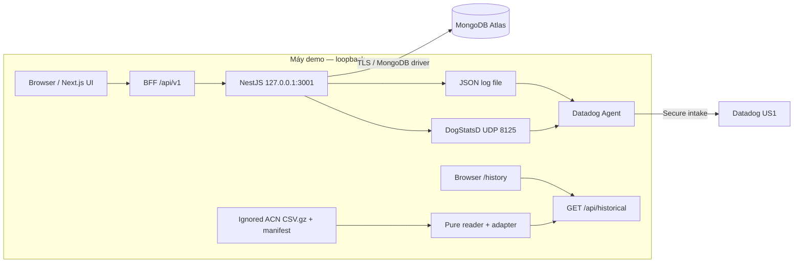
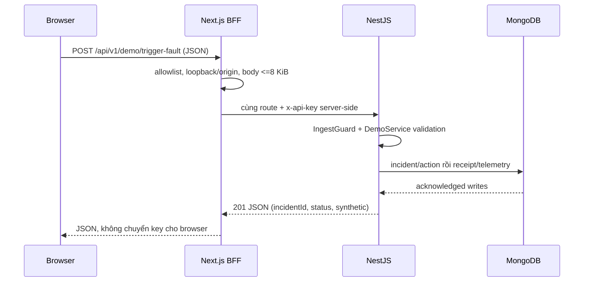
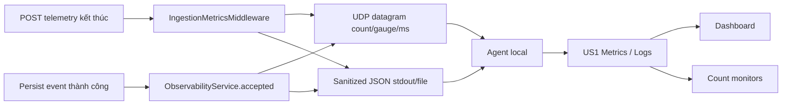
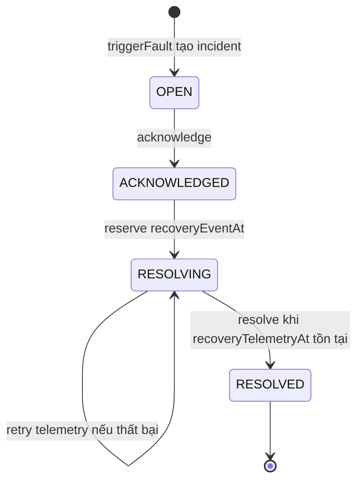
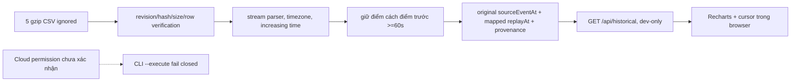
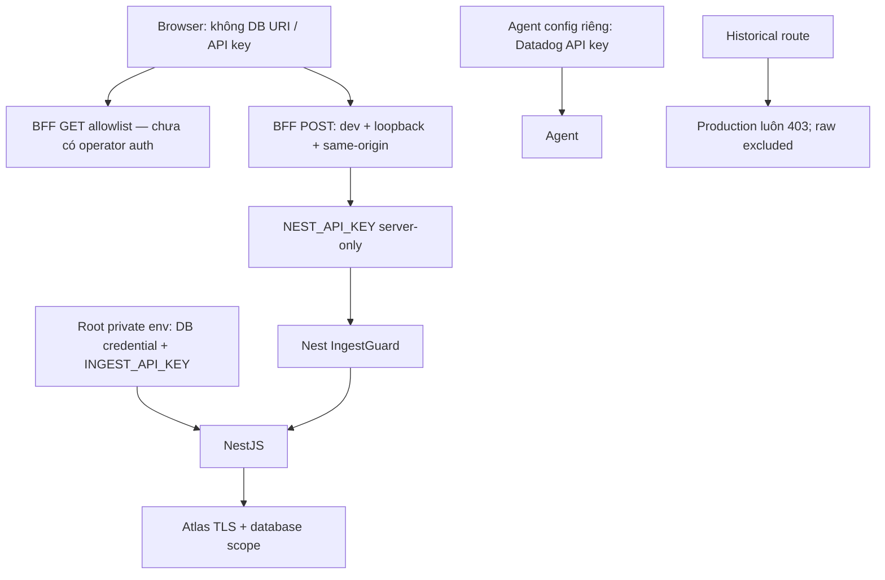

# 02 — Kiến trúc, runtime và lý do thiết kế

> Đối chiếu tại commit `334afdb`, ngày 19/10/2026. Đây là tài liệu học, không phải lần chạy cloud mới. Quy ước mức bằng chứng xem [hướng dẫn](README.md).

## 1. Đọc kiến trúc theo trách nhiệm

Một component là một phần có trách nhiệm riêng. Browser lo tương tác; BFF là server trung gian phục vụ đúng UI; NestJS giữ luật nghiệp vụ; MongoDB giữ dữ liệu; Agent chuyển tín hiệu quan sát; Datadog hiển thị và đánh giá luật. Không component nào trong nhánh ACN local gọi hai cloud sink này.

### A. Toàn hệ thống đang thực hiện

Mũi tên Files → reader là đọc file local, không phải tải từ Internet. Browser `/history` vẫn gọi HTTP local đến Next.js, nên “không network” chỉ đúng với reader không fetch cloud, không có nghĩa browser không dùng HTTP.

### B. Browser → BFF → API → database

Đây là nhiều write tuần tự, **không** transaction xuyên collection. Nếu write sau thất bại, các write trước có thể đã tồn tại.

### C. Observability

Gửi UDP thành công chỉ xác nhận local socket hoàn tất. Agent intake và monitor được xác nhận bằng evidence riêng. Không có trace/span/APM trong sơ đồ.

### D. Incident và monitor là hai luồng

`reset()` có đường quản trị demo riêng: đóng incident synthetic đang active bằng `baseline_reset`, rồi phát baseline cho cả năm. Đường đó bypass quy trình recovery thường; không được dùng để minh họa “đã sửa xong”. Monitor ALERT/OK không tự chuyển trạng thái incident.

### E. Historical độc lập

Không có mũi tên Chart/reader sang ingestion. CLI cloud replay là capability khác, bị gate; không phải đường đang chạy.

### F. Ranh giới bảo mật

Local policy giảm bề mặt cho demo, không xác thực danh tính con người. Host/Origin không phải access-control phù hợp cho một service bị expose công khai.

## 2. Từng công nghệ làm gì?

| Công nghệ | Trách nhiệm và implementation | Lợi ích / mất gì nếu bỏ | Đánh đổi và lựa chọn khác |
| --- | --- | --- | --- |
| Next.js 16 | App Router, pages và Node route handlers | UI và BFF cùng repo/runtime; bỏ đi phải thay router/server | SPA + API riêng đơn giản ở rendering nhưng cần boundary/key flow khác |
| React | Components, state/effect, polling và sự kiện nút | Render theo dữ liệu; thay bằng imperative DOM phải tự đồng bộ | State tăng phức tạp; không có store tập trung |
| TypeScript | Kiểm tra kiểu khi build, interface API | Bắt lỗi shape ở lúc compile | Không thay validation runtime; JSON vẫn cần Zod |
| Tailwind CSS | Utility classes, responsive grid và focus styles | UI thống nhất không phải viết mỗi CSS rule | Class dài; CSS modules/design system khác đều khả thi |
| Recharts | BarChart/AreaChart/LineChart với container responsive | Biểu đồ trong React | Nhiều điểm làm render nặng; chưa có benchmark lớn; có thể dùng ECharts |
| NestJS 11 | Module/DI/controller/service/guard/filter | Tách HTTP khỏi nghiệp vụ và dễ override trong test | Nhiều abstraction hơn Express thuần |
| MongoDB Atlas | Database cloud managed qua official driver | Persistence ngoài process | Phụ thuộc mạng, IP access, TLS, quota; có thể dùng MongoDB local |
| Time Series | `ts`, `meta`, TTL cho telemetry | Lưu dữ liệu theo thời gian | Không dùng unique measurement index làm dedup; receipt collection riêng |
| Aggregation Pipeline | Lọc/gom/sắp dữ liệu tại DB | Giảm dữ liệu phải trả browser | Query/scan/sort vẫn có chi phí; cần explain/load test |
| Datadog Agent | Nhận UDP và tail file, chuyển US1 | Ứng dụng không giữ key intake | Agent/network có thể lỗi; không có delivery guarantee của app |
| DogStatsD | Datagrams count/gauge/timer có tag | Dễ instrument, ít coupling với cloud | UDP có thể mất; direct HTTPS API cần credential/retry/batching riêng |
| Metrics | Tín hiệu số theo thời gian/tags | Xu hướng và luật count | Không phải ledger event, tag cardinality ảnh hưởng chi phí |
| Logs | JSON event allowlist có context | Điều tra cùng incident/run ID | Bỏ stack/raw error để giảm rò rỉ làm mất chi tiết debug |
| Dashboard | 11 widget từ JSON artifact | Một mặt phẳng nhìn vận hành | Không điều khiển incident, không chứng minh availability |
| Monitors | Hai luật sum một phút >=1 | Tự đánh giá tín hiệu | Không có heartbeat/no-data detector đáng tin cậy |

**VERIFIED IN SOURCE CODE:** [apps/api/src/app.module.ts:18](../../apps/api/src/app.module.ts#L18), [apps/api/src/bootstrap.ts:13](../../apps/api/src/bootstrap.ts#L13), [apps/web/src/app/layout.tsx:1](../../apps/web/src/app/layout.tsx#L1), [apps/web/next.config.ts:1](../../apps/web/next.config.ts#L1), [config/datadog/chargeguard-operations.dashboard.json:1](../../config/datadog/chargeguard-operations.dashboard.json#L1).

## 3. Network và dữ liệu đi qua đâu?

| Kết nối | Dữ liệu / định dạng | Validation / thời gian chờ | Secret ở đâu? |
| --- | --- | --- | --- |
| Browser → BFF | same-origin HTTP, JSON | allowlisted path/method; POST <=8192 byte và body allowlist | Browser không nhận backend key |
| BFF → API | `/api/v1/*`, GET hoặc POST JSON; chỉ POST có `x-api-key` | fetch no-store, timeout 10 s, chặn redirect 3 xx; lỗi proxy 502 | `NEST_API_KEY` trong web server env |
| API → Atlas | MongoDB wire protocol TLS, BSON | startup connect/ping; selection/connect timeout 10 s | Root `.env`, `MONGODB_URI`; không gửi browser |
| App → Agent | UDP `chargeguard.name:value|type|#tags` | fixed 127.0.0.1; finite numeric | Không cần Datadog key trong app |
| Log file → Agent | từng dòng JSON từ đường dẫn host chuẩn | field allowlist + rotation 5 MiB | Key của Agent trong config ngoài repo |
| Browser history → Next route | JSON points, original/replay times | opt-in, development, same-origin loopback, alias/speed bounds, no-store | Không DB/API key trong local reader |

Source chính: [apps/web/src/app/api/v1/[...path]/route.ts:160](../../apps/web/src/app/api/v1/[...path]/route.ts#L160), [apps/api/src/database/database.service.ts:12](../../apps/api/src/database/database.service.ts#L12), [apps/api/src/observability/observability.service.ts:40](../../apps/api/src/observability/observability.service.ts#L40), [apps/web/src/app/api/historical/route.ts:7](../../apps/web/src/app/api/historical/route.ts#L7).

## 4. Vì sao chọn như vậy? Phân biệt suy luận và lịch sử

Những trade-off sau là **ENGINEERING INFERENCE**, không phải lời khẳng định tác giả đã cân nhắc bằng benchmark hoặc ADR chính thức.

| Quyết định | Lập luận phù hợp với code | Khi lựa chọn khác tốt hơn |
| --- | --- | --- |
| MongoDB thay PostgreSQL/TimescaleDB | Document chứa sensor optional + provenance; Time Series và pipeline hợp yêu cầu đề | Quan hệ/ràng buộc join/giao dịch mạnh hoặc hệ thống đã dùng SQL có thể hợp PostgreSQL hơn |
| NestJS thay Express | DI/module/guard giúp test và phân trách nhiệm | API rất nhỏ hoặc team cần ít abstraction có thể chọn Express |
| Next.js thay SPA | BFF giữ key tại server, App Router cùng UI | Static hosting/SPA thuần cần backend auth đúng thay thế |
| BFF thay browser gọi API trực tiếp | Central allowlist, không lộ ingest key cho JavaScript | API với OAuth/token theo user có thể cho browser gọi trực tiếp |
| Time Series thay regular telemetry | Tối ưu mô hình theo thời gian ở DB | Unique constraints/update linh hoạt có thể hợp regular collection |
| Pipeline thay tính hết browser | Lọc bounded và gom trên server | Tập nhỏ local/offline có thể tính client; vẫn cần consistency |
| Datadog thay Prometheus/Grafana | Managed metrics/logs/monitor, đáp ứng đề | Chi phí/chủ quyền dữ liệu/năng lực vận hành có thể nghiêng self-hosted |
| DogStatsD thay direct API | Không đặt intake key trong application; Agent gom tín hiệu | Agentless serverless có thể cần HTTP exporter khác |
| Polling thay WebSocket/SSE | Dễ triển khai cho năm asset | Nhiều client, cadence thấp-latency cần push/backpressure |
| Synthetic faults thay lỗi thật | Reproducible, không tác động điện hoặc người dùng | Hardware-in-loop chỉ khi có lab, quyền và safety process |
| ACN local thay cloud | Scope permission chưa rõ; pure reader tách side effects | Chỉ mở cloud khi có grant, minimization và mapping được kiểm chứng |
| Manual action thay auto-remediation | Có operator/audit, không có actuation thật | Production có policy, RBAC, interlock và rollback mới xét tự động |

Không nói “MongoDB nhanh nhất”, “Datadog tức thời”, “đảm bảo exactly-once” hoặc “tự chữa sạc”. Câu bảo vệ: “Em tối ưu phạm vi MVP và khả năng kiểm chứng, đồng thời chỉ rõ phần cần đo và bổ sung trước production.”

## 5. Sai khác tài liệu phải biết

Đọc bảng audit trong [hướng dẫn](README.md). Đặc biệt sơ đồ cũ có đường replay có điều kiện không thể được trình bày như dữ liệu ACN đang vào cloud. Domain summary cũ dùng `syntheticFields/derivedFields`; code thực dùng `provenance.fields`. Đây là lịch sử thiết kế, không được âm thầm đổi tên khi thuyết trình.

## 6. Khi bỏ một thành phần: trách nhiệm phải được chuyển đi đâu?

Đây là suy luận thiết kế, không phải đề nghị thay stack trong task này. Lý do phù hợp không chứng minh đó là quyết định lịch sử đã được benchmark.

| Thành phần hiện có | Nếu bỏ | Lựa chọn thay và điều phải giữ |
| --- | --- | --- |
| Next.js | Mất App Router và route BFF trong cùng ứng dụng | SPA + server API khác; giữ secret phía server và route policy. |
| React | Mất state/effect/render theo dữ liệu | Vue/Svelte/DOM thuần; phải giữ loading/error/provenance. |
| TypeScript | Mất kiểm kiểu compile-time | JavaScript + kiểm tra khác; vẫn cần runtime schema. |
| Tailwind | Mất utility styles và responsive classes đang dùng | CSS Modules/CSS thuần; giữ focus, contrast, layout. |
| Recharts | Không còn chart components trong trang | ECharts/Chart.js/SVG; giữ null/missing và trục thời gian đúng. |
| NestJS | Mất module/DI/guards/controllers | Express/Fastify; phải viết lại các boundary và bảo toàn nghiệp vụ. |
| Atlas | Mất datastore cloud đang cấu hình | MongoDB tự quản hoặc database khác; phải kiểm vận hành/migration. |
| Time Series | Telemetry chuyển regular collection | Xem lại index/TTL/storage, không bỏ receipt đơn giản chỉ vì có thể thêm unique index. |
| Aggregation Pipeline | API không còn các phép gom tại DB | SQL aggregates hoặc xử lý server khác; tránh gửi toàn bộ dữ liệu ra browser. |
| Agent | App không còn forwarder UDP/log hiện tại | Exporter/direct HTTPS collector; cần credential và delivery design riêng. |
| DogStatsD | Không có metric datagrams hiện tại | OpenTelemetry metrics hoặc HTTP API; không tự có implementation chỉ vì nêu tên. |
| Datadog Metrics | Dashboard/monitors mất nguồn số | Backend metrics khác; không dùng log text tùy ý làm accounting thay DB. |
| Datadog Logs | Mất tìm event tập trung bằng incident/run ID | Local logs hoặc log platform khác; giữ redaction/correlation/retention. |
| Datadog Dashboard | Mất bố cục11widget | Grafana/UI riêng; vẫn cần giải thích semantics metric. |
| Datadog Monitors | Không có rule đánh giá ALERT/OK này | Alertmanager/rule engine khác; phải kiểm evaluation, missing data và notification policy. |

Trong runtime hiện tại, API vẫn ghi Atlas nếu metric tắt; Historical Local vẫn đọc file khi API/Agent không chạy. Tuy nhiên task học không tắt dịch vụ hay chạy fault để tái kiểm các giả định kiến trúc này; source dependency và test fixture là mức bằng chứng được dùng.
